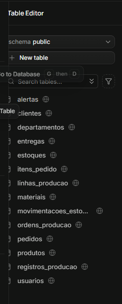

# Industrial Control Tower – Banco de dados

**Squad FNCS · Sprint 2 · João Vitor de Oliveira Souza**

O modelo de dados da Sprint 1 foi implementado em PostgreSQL no projeto Supabase `pcc-prys`. A migração `criar_industrial_control_tower` criou a estrutura usada para relacionar materiais e movimentações de estoque, pedidos de clientes, ordens de produção e entregas.

## Evidência da implementação



A captura mostra as 14 tabelas no esquema `public`. Após a migração, uma consulta ao catálogo do PostgreSQL confirmou **15 chaves estrangeiras** e **segurança por linha (RLS) habilitada nas 14 tabelas**.

## Regras implementadas

- Cada material pode ter um único registro em `estoques`.
- Uma movimentação de estoque aceita os tipos `ENTRADA` e `SAIDA`.
- Cada alerta deve referenciar pelo menos um material, pedido ou linha de produção.

## Como reproduzir a conferência

Execute a consulta no SQL Editor do projeto.

```sql
SELECT
  count(*) AS tabelas,
  count(*) FILTER (WHERE relrowsecurity) AS tabelas_com_rls,
  (SELECT count(*)
   FROM pg_constraint
   WHERE connamespace = 'public'::regnamespace
     AND contype = 'f') AS chaves_estrangeiras
FROM pg_class
WHERE relnamespace = 'public'::regnamespace
  AND relkind = 'r';
```

| Tabelas | Tabelas com RLS | Chaves estrangeiras |
| ---: | ---: | ---: |
| 14 | 14 | 15 |

A próxima etapa da sprint é integrar as operações de banco às rotas do backend e testar a gravação e a consulta de dados pela API.
